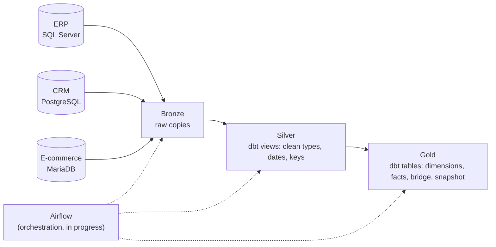

# Order-to-Cash Data Warehouse

A SQL Server data warehouse built with a **Bronze / Silver / Gold** (medallion) architecture, transformed with **dbt**, and fed by **three source systems on three different engines**: an ERP (SAP-shaped tables, SQL Server), a CRM (Odoo-shaped tables, PostgreSQL) and an e-commerce database (MariaDB).

It starts with the cash end of order-to-cash, **accounts receivable**; sales and logistics are planned as new marts on the same warehouse.

An **anonymized re-creation** of a data warehouse I built and run at work. It is written from scratch on **fictional, synthetic data**, and it reproduces the architecture, the design patterns and the kinds of problems I faced in the real project (late and partial payments, history that the source does not fully log, systems that disagree). No code, data, names or business rules from my employer are included.

Everything here runs locally with Docker.

> **Status: work in progress.** Sources, Bronze, Silver, Gold, tests and documentation are done. Airflow is installed and running with a health-check DAG; **the next step is the DAG that orchestrates the daily load** (three source loads in parallel, then dbt). See the [roadmap](#roadmap).

## What it demonstrates

| Skill | Where |
|---|---|
| Medallion architecture over three heterogeneous sources | `sql/`, `extractors/`, `dbt/` |
| ERP ingestion in T-SQL (full reload and incremental MERGE with a watermark) | `sql/01_bronze/` |
| CRM and e-commerce ingestion in Python (incremental, idempotent) | `extractors/` |
| Load framework: step-level log, rollback, source gating | `sql/00_control/` |
| Silver layer as dbt views with shared cleaning macros | `dbt/models/silver/`, `dbt/macros/` |
| Dimensional modeling: SCD Type 2 rebuilt from a change log | `dbt/models/gold/dim_customer_credit_history.sql` |
| Payment-to-invoice matching (one-to-one, many-to-one, waterfall, credit memos) | `dbt/models/gold/bridge_payment_application.sql` |
| Daily receivables snapshot with historical credit limits | `dbt/models/gold/fact_ar_snapshot.sql` |
| Cross-system consistency checks (does the e-commerce follow the ERP's rules?) | `dbt/tests/hold_rule_*` |
| dbt tests, reconciliation tests and failure storage | `dbt/tests/`, `dbt/models/*/_*.yml` |
| dbt snapshots for attributes the source does not log | `dbt/snapshots/` |
| Generated documentation and lineage | [dbt documentation site](https://romloc11.github.io/order-to-cash-dwh/dbt/), [docs/lineage.md](docs/lineage.md) |
| Orchestration with Apache Airflow (in progress) | `airflow/` |

## Architecture



How the Gold tables depend on each other: [docs/lineage.md](docs/lineage.md).

### Gold layer

| Table | Grain | What it answers |
|---|---|---|
| `dim_customer` | one row per customer | Current credit, payment terms, district, collector |
| `dim_customer_credit_history` | customer and credit limit version | What credit limit was in force on any past date (SCD2) |
| `dim_date` | one row per day | Calendar |
| `fact_invoice` | one row per invoice | Amount, due date, paid date, days late, aging bucket |
| `fact_payment` | one row per payment | Applied and unapplied payments |
| `fact_credit_memo` | one row per credit memo | Credit memos and the invoice they refer to |
| `bridge_payment_application` | payment (or credit memo) applied to an invoice | How much of each payment went to each invoice |
| `fact_ar_snapshot` | customer and day | Open invoices, unapplied credits, overdue balance, credit limit that day |
| `fact_web_order` | one row per web order | The customer's receivables position on the order date and the holds applied |

## The sources

**ERP** (`erp_source` database in SQL Server), SAP-shaped:
`KNA1` customers, `KNVV` sales data, `KNKK` credit, `KNVP` partner functions (collector), `BSID` open items, `BSAD` cleared items, `VBRK` billing, `CDHDR`/`CDPOS` change log.

**CRM** (`crm` database in PostgreSQL), Odoo-shaped:
`res_partner` (customer ref **without** leading zeros), `res_users`, `collection_activity` (calls, emails, promises to pay).

**E-commerce** (`ecommerce` database in MariaDB):
`orders` (web orders) and `order_holds` (orders held because of an ERP block, an exceeded credit limit or an overdue balance, with the time each one was held and released). Holds are derived from the customer's real credit state on the order date, so the e-commerce data agrees with the ERP data. This lets the warehouse answer: *how much sales value is held back by overdue receivables, and how long does it take to release it?*

### Hard cases injected on purpose

- One payment covering several invoices, several payments covering several invoices, and invoices paid in two parts.
- Credit memos netted against invoices.
- Payments cleared weeks after they were received (so *payment date* and *clearing date* differ).
- Payments that never match an invoice.
- Customer attributes that change over time, where roughly 8% of changes are missing from the change log.
- CRM and ERP disagreeing on the account owner for some customers.
- Customer numbers with leading zeros in the ERP and without them in the CRM.

The generator also writes the ground truth for payment application, so the matching logic can be checked against the answer.

### What the tests found

The consistency tests compare systems that should agree. Some differences are expected, and they trace back to the injected gap in the change log:

- 3 customers whose current credit limit differs from the last version rebuilt from the change log (`credit_history_matches_current`, severity `warn`).
- 9 web orders where the e-commerce held or released an order differently from what the rebuilt credit history says (`hold_rule_credit_limit_consistent`, severity `warn`). They belong to customers with unlogged limit changes.

Failing rows are stored in the `dq` schema (`store_failures`), so they can be queried with SQL.

## Run it

Requirements: Docker Desktop.

```bash
cp .env.example .env          # local throw-away passwords
docker compose up -d --build  # generates data, loads the three sources, creates the warehouse and Bronze objects
```

SQL Server listens on `localhost:1433` (user `sa`), PostgreSQL on `localhost:5432` (database `crm`, user `crm`) and MariaDB on `localhost:3306` (database `ecommerce`, user `root`).

Load Bronze (today by hand; the Airflow DAG will replace these steps):

```bash
docker compose exec sqlserver bash -c '/opt/mssql-tools18/bin/sqlcmd -C -S localhost -U sa -P "$MSSQL_SA_PASSWORD" -d dwh -Q "EXEC bronze.load_erp"'
docker compose run --rm extractors python -m extractors.crm
docker compose run --rm extractors python -m extractors.ecommerce
```

Build Silver, Gold and the customer snapshot with dbt, and run all the tests:

```bash
docker compose run --rm dbt build
```

The documentation site is published at <https://romloc11.github.io/order-to-cash-dwh/dbt/> (models, columns, tests, SQL and the lineage graph). To regenerate it locally after changing a model, and refresh the published copy:

```bash
docker compose run --rm dbt docs generate --static
cp dbt/target/static_index.html docs/dbt/index.html
```

Start Airflow (UI at <http://localhost:8080>, no login, local use only):

```bash
docker compose --profile orchestration up -d airflow
```

To regenerate the data with different settings:

```bash
python -m data_generator.generate --customers 500 --seed 42 --out data_generator/output
```

## Design decisions

- **Silver as views, Gold as tables.** Silver only cleans (types, dates, keys), so views keep it always in sync with Bronze. Gold holds the business rules and is materialized.
- **SCD2 from the change log, not from snapshots.** When the source records its own history, rebuild it; that recovers the past. A dbt snapshot is used only for attributes the log does not cover (customer name, tax ID), and it can only start recording from its first run.
- **A daily snapshot at customer-day grain.** It makes "what was this customer's balance and credit limit on that day?" a simple lookup, and lets other systems be checked against the ERP on any past date.
- **Business rules are tested, not stored as columns.** The rule "this order should have been held" lives in tests that compare against what the e-commerce did, rather than in a column of the fact table.
- **dbt and the extractors live in their own virtualenv inside the Airflow image**, so their dependencies never clash with Airflow's.

## How this was built

I used Claude as a tutor and pair programmer, and I want that to be clear.

- **Written by me:** the dbt Gold models (dimensions, facts, the payment application bridge, the daily snapshot and the web-order fact), the shared cleaning macros, the customer snapshot, the singular and reconciliation tests, and four Silver models (`erp_customers`, `erp_customer_credit`, `crm_partners`, `ecommerce_orders`). I can explain every line of them.
- **Generated or scaffolded by Claude:** the synthetic data generator, the T-SQL control and Bronze layer, the extractor framework, the Docker and Airflow setup, the remaining Silver models, and the column descriptions in the dbt YAML files.
- **Next:** the Airflow DAGs are mine to write, with Claude reviewing.

## Roadmap

- [x] Synthetic data generator (ERP, CRM, e-commerce) and source databases
- [x] Control layer and Bronze load for the ERP (T-SQL)
- [x] Bronze extractors for e-commerce and the CRM (Python)
- [x] Silver layer (dbt)
- [x] Gold layer: dimensions (SCD2), facts, payment application bridge, daily snapshot (dbt)
- [x] Data tests, reconciliation tests and stored failures
- [x] dbt snapshots, macros and generated documentation
- [x] Airflow running in Docker with a health-check DAG
- [ ] **Airflow DAG for the daily load: three loads in parallel, gate on all of them, then `dbt snapshot` and `dbt build`** (next)
- [ ] Retries, failure handling and scheduling with backfills
- [ ] Python tests against the generator's ground truth
- [ ] CI with GitHub Actions
- [ ] More business areas as new Gold marts (sales, logistics)
