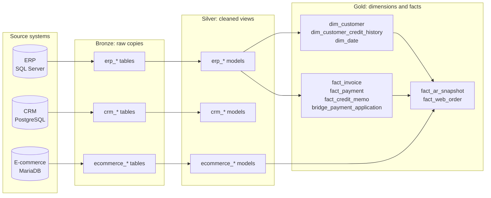
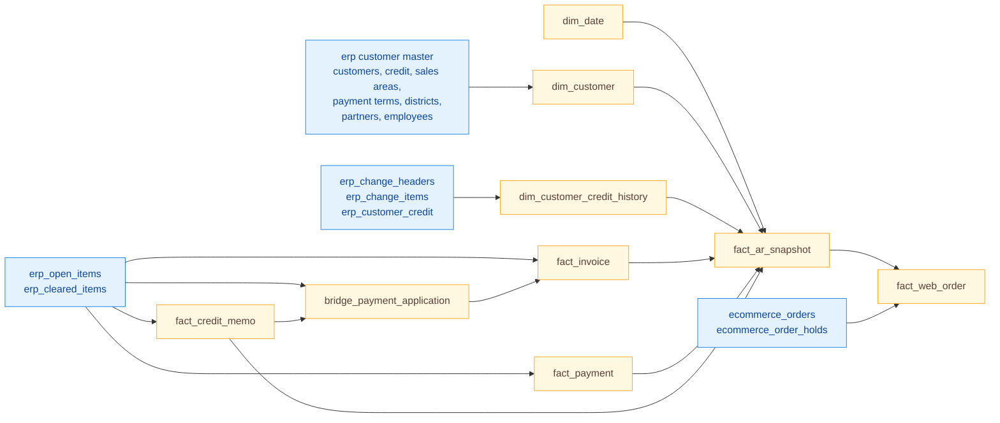

# Data lineage

Two views of how data flows through the warehouse. The first one shows the layers, the second one shows how the Gold tables depend on each other.

The generated dbt documentation site (`dbt docs generate`) is the source of truth for lineage; these diagrams are a readable summary of it.

## Layers

## Gold models

Reading it from the bottom up: `fact_web_order` needs the customer's receivables position on the order date (`fact_ar_snapshot`), which in turn needs every invoice, payment and credit memo, the credit limit in force on that day (`dim_customer_credit_history`) and the calendar (`dim_date`).
